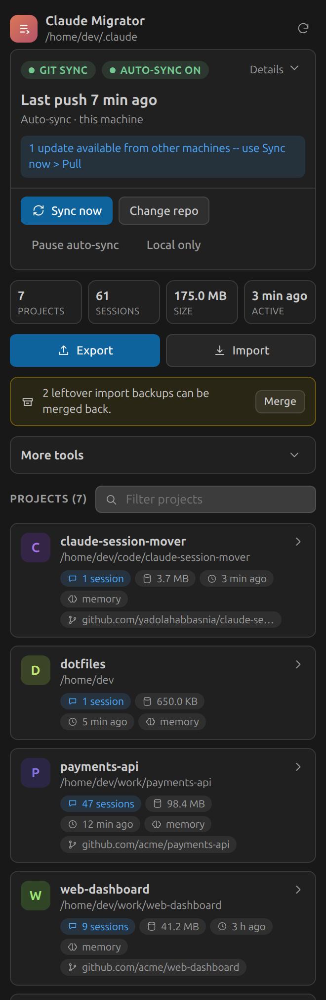
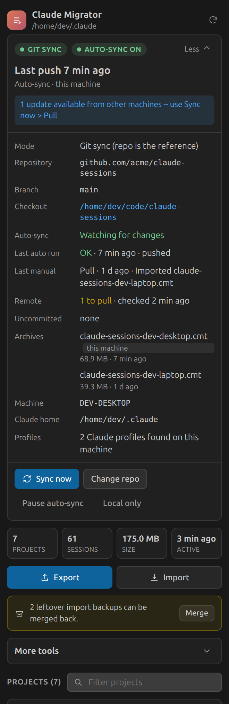
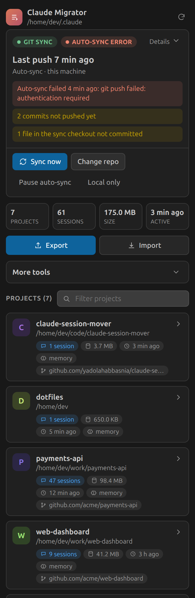
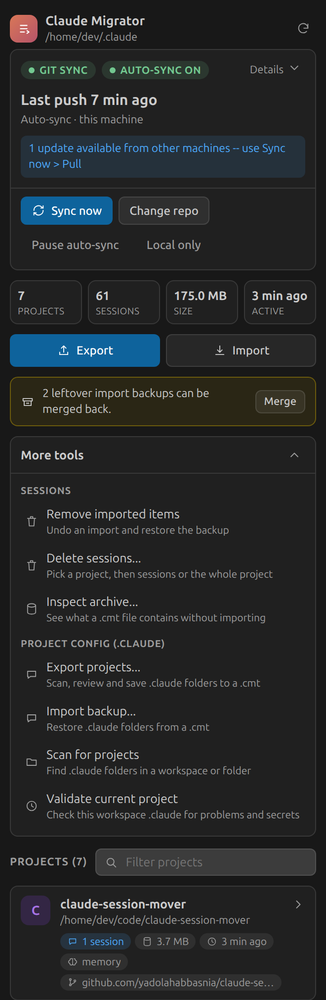
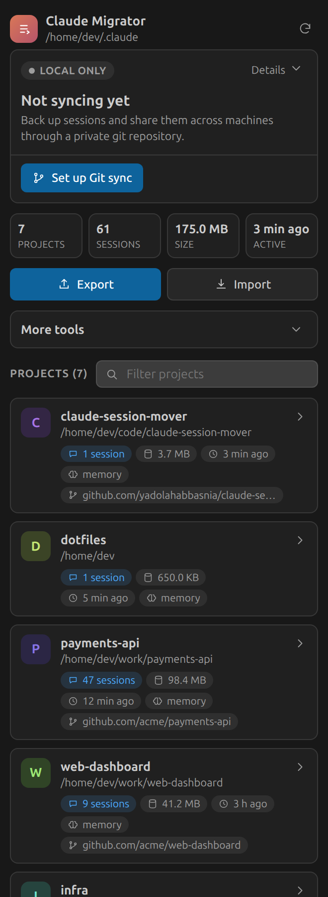

# Claude Project Migrator

Move your **Claude Code sessions** and **project config** between machines -- or keep them in sync
automatically through a private git repository -- with machine-specific paths rewritten along the
way, even across different operating systems, usernames, home directories and project locations.

<table>
  <tr>
    <td></td>
    <td></td>
    <td></td>
  </tr>
  <tr>
    <td align="center">Overview</td>
    <td align="center">Sync details</td>
    <td align="center">Problems surfaced on the card</td>
  </tr>
</table>

> Screenshots use sample data.

## Contents

- [What it moves](#what-it-moves)
- [Install](#install)
- [Quick start](#quick-start)
- [The sidebar](#the-sidebar)
- [Sync sessions through git](#sync-sessions-through-git)
- [Commands](#commands)
- [Working with sessions](#working-with-sessions)
- [Project config (`.claude`)](#project-config-claude)
- [How it works](#how-it-works)
- [Security](#security)
- [Settings](#settings)
- [Limitations](#limitations)
- [Development](#development)

## What it moves

1. **Claude Code sessions** -- the conversation history Claude Code keeps per project under
   `~/.claude/projects/<encoded-path>/*.jsonl`, plus each project's `memory/` folder.
2. **Project config** -- a project's own `.claude/` directory (commands, agents, settings) that
   lives inside its repository.

Both travel in the same portable archive format (`.cmt`) and go through the same safety machinery:
checksum-verified extraction, automatic destination matching, a dry-run preview, a mandatory backup
before anything existing is touched, and a post-import health check.

You can move archives by hand, or let the extension [sync sessions through a git
repository](#sync-sessions-through-git) for you.

## Install

This extension is not on the VS Code Marketplace. Install the `.vsix` from the latest
[GitHub release](https://github.com/yadolahabbasnia/claude-session-migrator/releases), or build it:

```bash
npm install
npm run package        # produces claude-project-migrator-<version>.vsix
code --install-extension claude-project-migrator-<version>.vsix
```

Then reload VS Code. Requirements: VS Code 1.85+, and `git` on your `PATH` if you want git sync.

## Quick start

**Move sessions by hand**

1. Open the **Claude Migrator** icon in the Activity Bar.
2. On the old machine: **Export** -> pick projects -> review -> save a `.cmt` file.
3. Copy the file over. On the new machine: **Import** -> pick the file -> confirm the preview.

**Keep machines in sync through git**

1. Create an empty private repository (GitHub, GitLab, anything git can push to).
2. In the sidebar, click **Set up Git sync** and enter the repository URL and a local folder.
3. Done. From now on sessions are pushed automatically a few seconds after they change. On another
   machine, set up the same repository and use **Sync now -> Pull** to import.

## The sidebar

A live view over your Claude Code sessions, from the Activity Bar.

**Sync card** -- always on top:

- Current mode (*Git sync* or *Local only*) and whether auto-sync is on, watching, waiting to settle
  (with a countdown), syncing right now, or has failed.
- When the last push happened, whether it was automatic or manual, and from which machine.
- Problems shown directly on the card, not only in a log: a failed auto-sync run, commits not
  pushed yet, updates waiting from other machines, uncommitted files.
- **Details** expands: repository, branch, checkout path, last automatic/manual run, remote status
  (ahead/behind and when it was last checked), every machine's archive with size and push time,
  your machine name, the Claude profile in use, and how many profiles were found.
- Buttons: **Sync now**, **Change repo**, **Pause/Resume auto-sync**, **Local only**.

**Below the card**

- Totals: projects, sessions, size, last activity.
- **Export** / **Import** for sessions.
- A banner when leftover import backups can be [merged back](#merging-leftover-import-backups).
- **More tools** (collapsible) -- every other command: remove imported items, delete sessions,
  inspect an archive, export/import/scan/validate project config.
- A filterable list of project cards (session count, size, last activity, memory and git-remote
  chips). Expand one to export it, reveal it, delete it, or open and delete individual sessions.
  Clicking a session shows a condensed preview of its conversation.

<table>
  <tr>
    <td></td>
    <td></td>
  </tr>
  <tr>
    <td align="center">More tools</td>
    <td align="center">Before git sync is set up</td>
  </tr>
</table>

Everything in the sidebar is also available from the Command Palette. Only *Export This Project*
lives solely in the Explorer's right-click menu, because it needs a folder as context.

## Sync sessions through git

Sync sessions between machines through a git repository you dedicate to this purpose, instead of
copying `.cmt` files around.

### How it works

- **One archive per machine.** Each machine pushes `claude-sessions-<hostname>.cmt`, so machines
  never overwrite each other's sessions. **Pull** lists the archives from *other* machines (newest
  first) and imports the one you pick. A legacy single `claude-sessions.cmt` shows up there too.
- **Push** runs the normal export wizard (project selection, security review), writes the archive
  into the repository checkout, commits and pushes. If the push is rejected because another machine
  pushed first, it rebases and retries once.
- **Pull** fetches the latest commit and runs the normal import wizard against the archive you
  chose. A pull that fails (diverged history, dirty checkout) reports the git error instead of
  silently leaving you on an old commit.
- **Auto-sync.** While mode is *Git sync* and auto-sync is on, the extension watches
  `<claudeHome>/projects/` and about 15 seconds after changes settle, exports and pushes. It only
  ever writes into the sync checkout, never into `~/.claude/projects/`, and never prompts. Failures
  are logged, shown on the sync card, and retried on the next change.

### Safeguards

- **Right repository only.** Before every push or pull the extension checks that the local folder's
  git remote matches the configured repository URL, and refuses to continue otherwise. A folder you
  pick that isn't a checkout is treated as a *parent* and a subfolder is created inside it.
- **Secrets never drop sessions.** Auto-sync keeps every session file and only replaces text that
  looks like a secret with `[REDACTED:<rule>]`. In the manual push wizard, "Replace secrets with
  placeholders" is the first choice, and dismissing the prompt cancels the export instead of
  silently excluding the file.
- **Shrink guard.** If a new archive is less than half the size of the one already in the repo,
  manual push asks you to confirm and auto-sync skips the push and says why.
- **Sizes.** Sizes shown before export are uncompressed; the `.cmt` is a compressed zip and is
  smaller (for example 175 MB of sessions becomes roughly 70 MB).

### Switching and multiple accounts

- **Change repo / go local.** *Change Git Sync Repository* points at a different repo or folder at
  any time (re-validated first). *Use Local Sessions Only* switches back to `local` mode without
  deleting anything and keeping your repo settings, so you can resume later.
- **Multiple Claude accounts.** If more than one Claude Code config directory exists on the machine
  (the active `CLAUDE_CONFIG_DIR` or `~/.claude`, plus siblings such as `~/.claude-work`), the
  wizard asks which profile to sync instead of guessing.

Requires `git`, and for a private repository whatever credential helper or SSH key you normally
use for that remote.

## Commands

All commands are under the **Claude Migrator** category in the Command Palette.

| Command | What it does |
| --- | --- |
| Export Sessions | Exports Claude Code session history from `~/.claude/projects/` to a `.cmt`. |
| Import Sessions | Imports session history from a `.cmt` into `~/.claude/projects/`. |
| Sync Sessions via Git | Push or pull sessions through the configured git repository. |
| Change Git Sync Repository | Switch the sync repository and/or local checkout. |
| Use Local Sessions Only | Stop treating the git repo as the reference; deletes nothing. |
| Merge Session Backups | Fold leftover `.backup-<timestamp>` folders back into their project. |
| Delete Sessions | Delete one session, several, or a whole project (to the system trash). |
| Remove Imported Items | Undo an earlier import and restore its backup. |
| Inspect Backup | Show what a `.cmt` contains without importing it. |
| Export Projects | Export `.claude` project config (scan, select, security review, save). |
| Import Backup | Import project config from a `.cmt`. |
| Scan for Claude Projects | Find `.claude` directories in the workspace or a chosen folder. |
| Validate Current Project | Check the workspace's `.claude` for structural problems and secrets. |
| Export This Project | Explorer right-click: export one folder's `.claude`. |

## Working with sessions

### Export and import

**Export** scans `~/.claude/projects/`, lets you multi-select projects, runs the security scan and
review, and writes a `.cmt`.

**Import** opens a `.cmt`, verifies it, lets you pick projects, matches each to a destination
folder (git remote, then same folder name, then the single open workspace), shows a dry-run preview,
and only then writes. The destination folder name is computed by running Claude Code's own
path-encoding algorithm against the destination, so imported sessions land exactly where Claude
Code will look for them -- no registration step. Every `.jsonl` line is treated as its own JSON
document: a line whose path rewrite would corrupt it is reverted alone, without discarding the rest
of the session.

### Re-importing (incremental updates)

If a session already exists at the destination, choose **Merge** instead of **Backup and
replace**. For `.jsonl` files, merge matches entries by their `uuid` and writes the union:
duplicates are not added, new incoming entries are appended, and local-only entries are kept.
Re-importing the same archive twice is a no-op. A backup of the pre-merge file is still taken.

### Merging leftover import backups

Importing with *Backup and replace* first copies the existing project folder to
`<project-folder>.backup-<timestamp>` next to it. Left alone these would look like duplicate
projects, so the sidebar hides them and shows a banner instead. **Merge Session Backups**:

1. copies every `.jsonl` session and `memory/` file the backup has that the live project doesn't,
   by file name;
2. **never overwrites** anything already in the live project -- a name collision is left alone and
   reported;
3. optionally moves the now-redundant backup folder to the system trash.

A backup whose original project no longer exists is left as an ordinary project.

### Deleting sessions

From the sidebar or **Delete Sessions**: one session (trash icon), several (tick and *Delete
Selected*), or a whole project. Every delete shows what goes away and moves items to the **system
trash** (falling back to permanent delete only where trashing isn't supported, and saying so).
Deleting a *project* also removes its `memory/` folder; deleting *sessions* never touches it.
Targets are re-derived and validated against the sessions root before anything is removed, and the
sidebar re-scans first so a stale list can't delete the wrong thing.

## Project config (`.claude`)

**Export** -- find projects (workspace scan, a chosen folder, or an explicitly requested list of
common developer directories -- never your whole disk), multi-select, choose options (path
migration, security scan and compression are on by default; including the hostname is an opt-in),
review the security findings per file (exclude, redact, or include), review the summary, save.

**Import** -- pick a `.cmt`; it is validated (manifest, format version, every SHA-256 checksum)
before extraction; each project is matched to a destination (git remote, same name, or the only
open workspace -- otherwise you are asked, it never guesses); a dry-run preview shows new, modified
and preserved files and path references to rewrite; if `.claude` already exists you choose **Backup
and replace**, **Merge**, **Skip** or **Cancel**; a timestamped `.claude.backup-<timestamp>` is
always made first; after confirmation it is applied, then a health check runs and a report is shown.

## How it works

**Session folder names can't be decoded.** Claude Code names a project's session folder by taking
its absolute path and replacing every character that isn't `[a-zA-Z0-9]` with `-` (longer than 200
characters it truncates and appends a hash). That is lossy and one-way. So this tool never decodes
it. It reads the `cwd` Claude Code records inside each session's `.jsonl` (from the most recently
modified session) as the source path, and computes the destination folder name by running the same
encoding forward. A project with no recorded `cwd` shows an unknown source: it still exports and
imports, but its paths can't be migrated.

**Path migration.** Every absolute path in a text file is classified against three roots, most
specific first: `$PROJECT_ROOT`, `$WORKSPACE_ROOT`, `$HOME`. A path under one of them is rewritten
to the destination's equivalent in its native separator style. A path that matches none is left
untouched and reported; the extension never guesses. JSON (and each `.jsonl` line) is only rewritten
if the result still parses. Binary files are copied byte for byte. Paths are parsed with
`path.win32`/`path.posix` explicitly, so a Windows-authored file migrates correctly on Linux.

**Project identity.** A stable id derived from the git remote (so `git@github.com:org/repo.git` and
`https://github.com/org/repo.git` match across machines), falling back to the project name plus a
hash of its path.

**Archive format (`.cmt`).** A ZIP file:

```
manifest.json                # format + tool version, source machine info,
                             # a `projects` list (config) and a `sessionProjects` list (sessions)
checksums.json               # archive path -> SHA-256 for every archived file
projects/<id>/claude/...     # each project's .claude contents, unmodified
sessions/<id>/data/...       # each session project's *.jsonl + memory/, unmodified
```

The manifest includes the platform and home directory (needed to rebuild `$HOME` context) but not
the username, and the hostname is `"redacted"` unless you opt in. Archives from before session
support have no `sessionProjects` key, which is treated as empty.

## Security

- A lightweight regex scanner flags AWS keys, Anthropic/OpenAI keys, GitHub/Slack tokens, bearer
  tokens, PEM private keys, and generic `key`/`token`/`secret`/`password` assignments. It catches
  obvious accidents; it is not a guarantee. Review the findings yourself.
- Findings are always shown redacted (e.g. `AKIA****MNOP`); the full value is never logged or shown.
- Nothing is uploaded anywhere by the extension itself. Export writes a local `.cmt`; git sync
  pushes only to the repository you configured -- use a **private** one, since session transcripts
  can contain anything you discussed with Claude.
- Checksums are verified before extraction, and a backup is taken before any destructive change.

## Settings

| Setting | Default | Meaning |
| --- | --- | --- |
| `claudeMigrator.gitSync.repoUrl` | `""` | Repository used to sync sessions. |
| `claudeMigrator.gitSync.localPath` | `""` | Local checkout of that repository. |
| `claudeMigrator.gitSync.branch` | `main` | Branch to pull from and push to. |
| `claudeMigrator.gitSync.archiveFileName` | `claude-sessions.cmt` | Base name; the machine name is added to it. |
| `claudeMigrator.gitSync.mode` | `local` | `local` or `git`. Switched to `git` the first time you set up sync. |
| `claudeMigrator.gitSync.autoSync` | `true` | Push automatically in `git` mode. |
| `claudeMigrator.scanDirectories` | `[]` | Extra directories offered when scanning for projects. |
| `claudeMigrator.scanMaxDepth` | `6` | How deep to look when scanning. |
| `claudeMigrator.debugLogging` | `false` | Verbose output in the "Claude Migrator" channel. |

## Limitations

- Unresolved path references are reported but can't be re-mapped from inside the import wizard; you
  can edit those files afterwards.
- The **Merge** strategy for JSON config is a one-level-deep structural merge (incoming keys win),
  not a semantic three-way merge. `.jsonl` transcripts merge by entry `uuid` instead.
- In VS Code Remote (SSH, WSL, Dev Containers) the extension works on the remote filesystem, so an
  export taken there is a file on the remote host.
- The secret scanner is intentionally simple.
- Auto-sync status ("last run", watcher state) lives in memory and resets when VS Code restarts; the
  last push time always comes from git itself.
- The git sync's remote status (ahead/behind) reflects the last fetch and does not hit the network.

## Development

```bash
npm install
npm run watch          # esbuild --watch
```

Press `F5` with this folder open to launch an Extension Development Host.

```bash
npm run typecheck
npm run lint
npm test               # vitest: path resolution across Windows/macOS/Linux combinations,
                       # session path encoding and discovery, archive round-trips and checksums,
                       # the migration engine's backup/merge/rollback, git sync (including two
                       # machines against a real bare repository), the auto-sync watcher with
                       # real files and git, and the sidebar markup
npm run package        # production bundle + vsce package -> claude-project-migrator-<version>.vsix
```

Unit tests run on plain Node against fixtures in `test/fixtures/`; they do not need a VS Code host.
The interactive wizards (QuickPick, OpenDialog) are exercised manually with `F5`.
